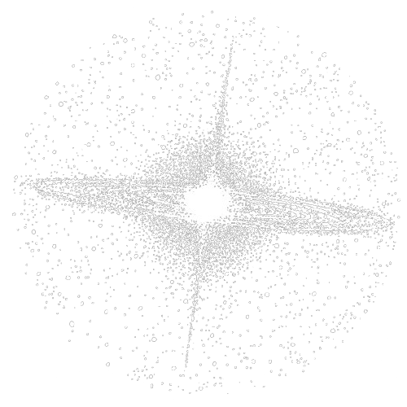

<p align="center">
  
</p>

<h1 align="center"><a href="https://cosmox.vercel.app/">Cosmos</a></h1>

<p align="center">
  <b>Experience the infinite.</b> A 3D space exploration simulator featuring the Solar System, the Quantumania realm, and cosmic easter eggs.
</p>

<p align="center">
  
  
  
  
  
</p>

> [!NOTE]
> **Personal project:** I've always been fascinated by space and the vastness of the cosmos. That passion inspired me to build this project. Feel free to explore and learn from it!

## Explore Cosmos

Open [cosmox.vercel.app](https://cosmox.vercel.app/) in a browser with WebGL support.

Use the radar to search for objects and travel directly to them. Open Settings to change the simulation date, time speed, graphics quality, and viewing aids. Start with Low quality on slower devices.

## Features

- **Solar System:** Explore eight planets, five recognised dwarf planets, 21 moons, Halley's nucleus, and representative asteroid and Kuiper belts at a consistent physical scale.
- **Dated simulation:** Start at the current UTC date, choose another date, accelerate time, or pause. Object information includes astronomical facts and source links.
- **Space flight:** Navigate with keyboard, mouse, gamepad, or touch controls. Select an object to orbit it or return to the Solar System overview.
- **Fictional destinations:** Visit Quantumania, Arishem, Alien X, the black hole, and other easter eggs. Turn off Fictional extras for an astronomy-only view.
- **Visuals:** Custom shaders provide the Sun's surface and corona, Earth's day/night cycle, atmospheric glow, and a raymarched black hole.
- **Viewing options:** Adjust quality, orbit guides, labels, automatic exposure, and dark-side fill light.

The physical model combines planetary ephemerides with approximate moon and small-body orbits. Read [COSMOS.md](COSMOS.md) for its sources and accuracy limits.

## Controls

| Action | Keyboard / mouse | Gamepad |
|---|---|---|
| Move | W/A/S/D, R/F | Left stick |
| Look / orbit selected object | Arrow keys or drag the view | Right stick |
| Roll | Q/E | L1/R1 |
| Boost | Hold Shift | RT |
| Zoom | Scroll wheel | D-pad up/down |
| Next object | N | |
| Top view | T | |
| Unlock object | Escape | |
| Toggle labels / HUD | L / H | |
| Return to overview | Home or Settings → Reset view | |
| Navigate interface | Tab | |

On touch devices, hold the flight, boost, roll, and zoom buttons, and drag the view to look. The object list also provides direct travel.

## Run locally

Use Node.js 24, or Node.js 22.13+ on the 22.x line.

```bash
git clone https://github.com/qtremors/cosmos.git
cd cosmos/cosmos-app
npm ci
npm run dev
```

Open [localhost:5173](http://localhost:5173).

## For developers

| Document | Purpose |
|---|---|
| [DEVELOPMENT.md](DEVELOPMENT.md) | Setup, architecture, configuration, testing, and performance profiling |
| [COSMOS.md](COSMOS.md) | Reference frames, physical model, sources, and accuracy limits |
| [TASKS.md](TASKS.md) | Unfinished work and acceptance criteria |
| [CHANGELOG.md](CHANGELOG.md) | Version history |

Report bugs or request features through [GitHub Issues](https://github.com/qtremors/cosmos/issues).

## License

Cosmos is source-available under the **Tremors Source License (TSL)**. Viewing, forking, and derivative works require attribution; commercial use requires written permission.

Read [LICENSE.md](LICENSE.md). Third-party libraries and assets remain subject to their respective licenses and attribution requirements.

---

<p align="center">
  Made by <a href="https://github.com/qtremors">Tremors</a>
</p>
